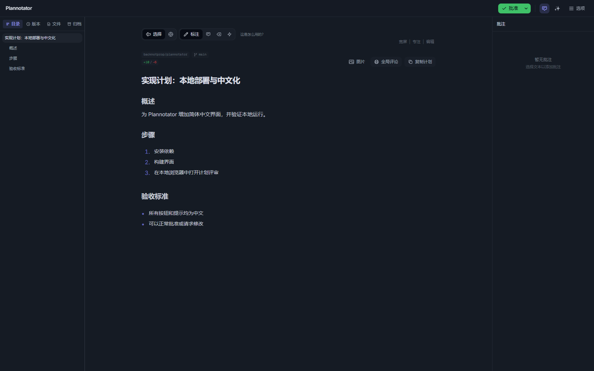
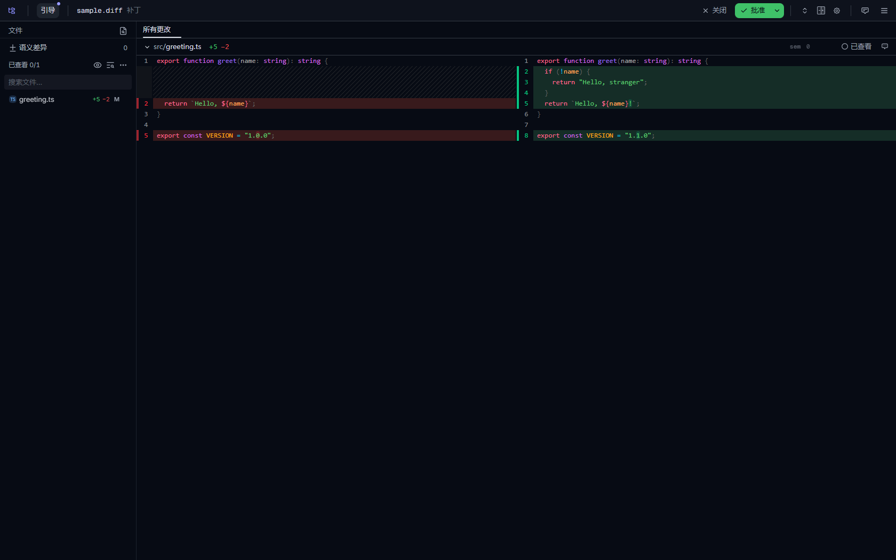
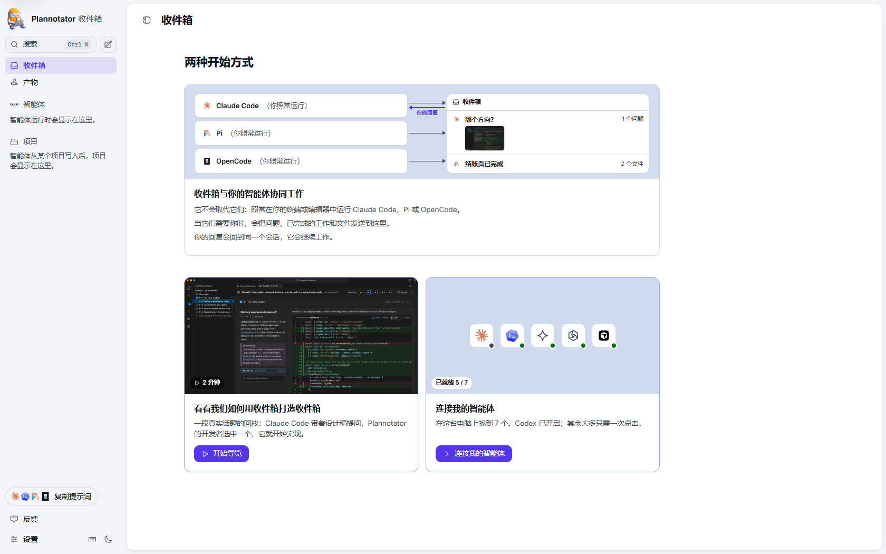
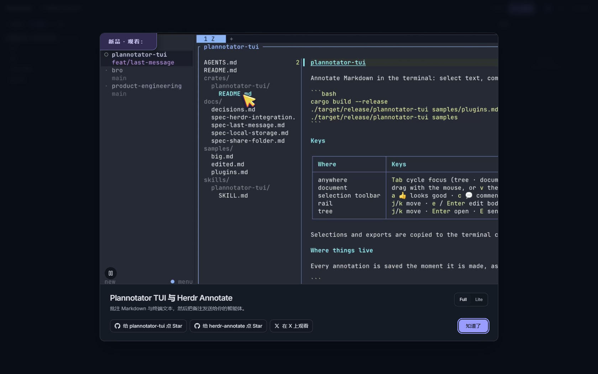
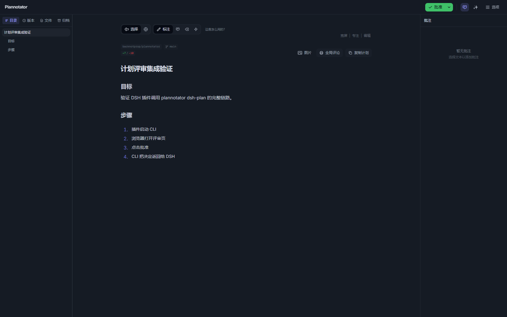
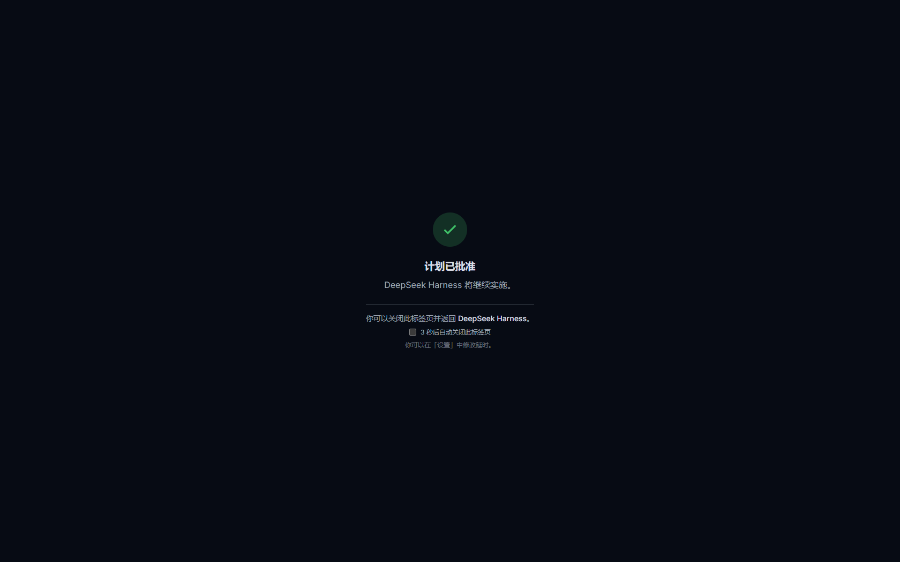

# Plannotator 本地部署 + 简体中文化说明

> 本仓库是 [Plannotator](https://github.com/backnotprop/plannotator) 的本地分支，已完成**面向用户界面的简体中文化**并验证可在 Windows + Bun 下本地运行。
> 适用对象：想在本机用 AI 编码助手（Claude Code、Codex、DeepSeek Harness、OpenCode、Pi 等）配合 Plannotator 做「计划评审 / 代码审查 / 文档批注 / 收件箱」的开发者。

---

## 1. 这是什么，为什么对 AI coding 有帮助

Plannotator 是一个**跑在本地浏览器里的评审界面**，由 AI 编码助手通过 hook / 插件调起：

- **计划评审（Plan Review）**：助手在计划模式提出方案时，浏览器自动打开计划 Markdown。你可以逐段批注、划词评论、直接改字，然后「批准 / 拒绝 / 附言批准」，反馈结构化地回到助手会话里，助手按批注继续执行。
- **代码审查（Code Review）**：对本地 `git diff`、PR/MR、补丁文件做类似 GitHub 的并排/堆叠差异审查，行级评论、文件树、提交反馈。
- **批注（Annotate）**：把任意 Markdown、文本、HTML、URL、文件夹变成可批注页面，用来审 PRD、spec、文档、HTML 原型。
- **收件箱（Inbox）**：多个 agent 会话把问题、决定、文件、审查请求发到一个本地窗口，你有空时统一处理，回复会回到对应会话（多 agent 并行时特别有用）。

对你的意义：AI coding 最大的浪费是「助手猜错方向后写了 500 行」和「你只能靠聊天文字描述哪里不对」。Plannotator 把「评审」变成可视化、可批注、可回传的闭环，显著提高一次通过率。

### 汉化后的界面截图（本机实拍）

| 计划评审 | 代码审查 |
|---|---|
|  |  |

| 收件箱 | 首次进入公告（中文） |
|---|---|
|  |  |

| DSH 集成：计划评审 | DSH 集成：批准后 |
|---|---|
|  |  |


---

## 2. 环境要求

| 依赖 | 版本 / 说明 |
|---|---|
| Windows | 10/11（本说明以 PowerShell 为例；macOS/Linux 同理） |
| [Bun](https://bun.sh/) | 本仓库验证版本 **1.3.14**。`bun --version` 检查 |
| Node.js | 仅用于 Playwright 截图等辅助脚本，**运行 Plannotator 本身只需要 Bun** |
| 浏览器 | Chrome / Edge 等任意现代浏览器 |

> 注意：用 Bun **编译独立二进制**要求 Bun ≥ 1.4.4（仓库 `scripts/require-bun.ts` 会检查）。本说明采用「源码运行」方式，不需要升级 Bun、也不需要编译二进制。

---

## 3. 一次性安装

```powershell
cd <你的仓库路径>
bun install
```

首次安装会拉取 npm 依赖，并执行 `postinstall` 生成 guide-viewer 清单，属正常现象。

---

## 4. 五种本地运行方式

### 方式 A：开发预览（最快看到界面，带演示数据）

```powershell
# 计划评审界面（内置演示计划，端口 3000）
bun run dev:hook

# 代码审查界面（内置演示 diff，端口 3001）
bun run dev:review
```

浏览器打开 <http://localhost:3000>（计划评审）或 <http://localhost:3001>（代码审查）即可。
这两个命令使用 Vite 开发服务器 + mock API，**不需要** agent、不需要构建产物，适合先看界面和调 UI。

### 方式 B：构建生产产物（真实使用前先构建）

```powershell
# 1) 先构建 review（代码审查 UI），再构建 hook（计划评审 + 收件箱外壳）
$env:NODE_OPTIONS = "--max-old-space-size=8192"
bun run --cwd apps/review build
bun run build:hook
```

构建产物：

| 文件 | 用途 |
|---|---|
| `apps/hook/dist/index.html` | 计划评审 / 批注主界面 |
| `apps/hook/dist/review.html` | 代码审查界面 |
| `apps/hook/dist/inbox.html` | 收件箱窗口 |
| `apps/hook/dist/surface.html` / `shape.html` | 手机壳 / Shape 页面 |

> **内存提示**：`build:hook` 会把收件箱等大页面打包成单文件 HTML，默认 Node 堆内存（约 2 GB）可能 OOM（`JavaScript heap out of memory`，exit code 134）。上面的 `NODE_OPTIONS=--max-old-space-size=8192` 是必须的。构建顺序不能反：先 review，后 hook，否则会打包进旧的 review HTML。

### 方式 C：注册全局 `plannotator` 命令（推荐，接 agent 用这个）

仓库自带 `bin/plannotator.js`，它会用 Bun 直接运行 `apps/hook/server/index.ts`（即本仓库源码，改完即生效）：

```powershell
cd <你的仓库路径>
bun link
plannotator --help        # 应打印完整命令列表
```

`bun link` 会在 Bun 的全局 bin 目录注册 `plannotator` 命令（Windows 下通常是 `%USERPROFILE%\.bun\bin`，确保该目录在 `PATH` 中）。

> 也可以不注册全局命令，直接用 `bun bin/plannotator.js <子命令>`，效果等价。

### 方式 D：接入你的 AI 编码助手

`plannotator` 命令可用后，按助手安装 hooks / 插件（官方安装器会自动检测，但本仓库是本地源码版，推荐手动接入）：

- **Claude Code**：插件市场方式（`/plugin marketplace add backnotprop/plannotator` 然后 `/plugin install plannotator@plannotator`），或按 README 的「manual hook setup」在 `~/.claude/settings.json` 里把 `PermissionRequest` 的 `ExitPlanMode` hook 指向 `plannotator`。本地调试：`claude --plugin-dir ./apps/hook`。
- **DeepSeek Harness**：`dsh plugin --profile <profile> add @plannotator/dsh`，或在本仓库 `apps/dsh-plugin` 下本地开发。
- **OpenCode**：安装/配置 `@plannotator/opencode` 插件。
- **Pi**：`pi install npm:@plannotator/pi-extension`，用 `--plan` 或 `/plannotator-plan-mode`。
- **Codex / Copilot CLI / Gemini CLI / Kiro**：见各 `apps/<agent>/README.md`。

只要助手能调用到 `plannotator` 命令，计划评审就会在计划提出时自动打开；代码审查用 `/plannotator-review` 或 `plannotator review`。

### 方式 E：接入 DeepSeek Harness（本机已完成，可直接用）

本机 DSH 版本 `0.2.2-rc.1`，桌面端 profile 为 `desktop`（目录 `C:\Users\<你的用户名>\.dsh\profiles\desktop`）。已完成：

1. **构建并安装 DSH 插件**（本地 link 安装，改插件代码立即生效）：

   ```powershell
   bun run build:dsh
   dsh plugin --profile desktop add link:<你的仓库路径>/apps/dsh-plugin
   ```

   安装后 profile 的 `package.json` 里出现 `"@plannotator/dsh"`，DSH 的插件列表显示 `include:plannotator`（`@plannotator/dsh`）为 **enabled / active**。

2. **编译独立 CLI**（不依赖 `bun` 在 PATH，DSH 重启后也能找到）：

   ```powershell
   New-Item -ItemType Directory -Force "$env:LOCALAPPDATA\plannotator"
   bun build apps/hook/server/index.ts --compile --outfile "$env:LOCALAPPDATA\plannotator\plannotator.exe"
   ```

   > 运行时 Bun 1.3.14 低于上游「编译二进制需 ≥1.4.4」的建议，该检查只影响发布产物的 TLS 信任链；本地环回使用无影响。如需完全合规，可先 `bun upgrade` 再重新编译。

3. **让插件用这个二进制**：在 `C:\Users\<你的用户名>\.dsh\profiles\desktop\cordis.patch.yml` 末尾加：

   ```yaml
   - id: plannotator
     config:
       binary: "C:/Users/<你的用户名>/AppData/Local/plannotator/plannotator.exe"
       planReview: true
   ```

   （原文件已备份为 `cordis.patch.yml.bak-plannotator`。）

4. **启用 DSH 的计划模式**（否则不会有 `exit_plan_mode`，计划评审无法触发）：
   DSH 插件管理器里开启 `include:plan-mode`，或让 Agent 通过 `plugin_manager` 设置。本机已开启（`enabled: true`，active）。

5. **打开收件箱工具**（可选，会让 DSH 每次请求多带一个工具定义）：在 `C:\Users\<你的用户名>\.plannotator\config.json` 写入

   ```json
   { "inboxTool": { "dsh": true } }
   ```

   **这项在 DSH 重启后生效。** 不想要就删掉这个键或改成 `false`。

6. **启动收件箱后台服务**：

   ```powershell
   & "$env:LOCALAPPDATA\plannotator\plannotator.exe" inbox --background
   & "$env:LOCALAPPDATA\plannotator\plannotator.exe" inbox status
   ```

   启动后监听本机的一个随机端口（例如 http://localhost:65451/），URL 以 `inbox status` 输出为准（数据目录 `C:\Users\<你的用户名>\.plannotator`）。

**已验证的完整链路**（不依赖 GUI）：以 DSH 插件相同的方式执行

```powershell
'{"plan":"# 计划评审集成验证 ...","cwd":"<你的仓库路径>"}' |
  plannotator dsh-plan
```

页面打开后点「批准」，CLI 返回 `{"approved":true,"savedPath":"...\plans\plan-2026-11-19-approved.md"}`，即插件拿到的决定格式。截图见上方「DSH 集成」两张。

**日常使用**：在 DSH 里切到计划模式，助手结束计划时就会弹出 Plannotator 评审页；`/plannotator-review`、`/plannotator-annotate`、`/plannotator-last` 可直接打开对应界面，不阻塞会话；你的反馈会作为新一轮消息回到会话。

**撤销 DSH 集成**：`dsh plugin --profile desktop remove @plannotator/dsh`；计划模式可在插件管理器里关掉 `include:plan-mode`；删掉上面 `cordis.patch.yml` 的三行配置即可。

---

## 5. 日常命令速查

```powershell
plannotator review                    # 审查当前未提交改动
plannotator review main               # 与 main 分支对比
plannotator review --staged           # 审查已暂存改动
plannotator review <PR/MR 链接>        # 审查 GitHub PR / GitLab MR
plannotator review --patch-file x.diff # 审查静态 diff 文件

plannotator annotate README.md         # 批注本地 Markdown
plannotator annotate src/              # 批注文件夹里的文件
plannotator annotate https://example.com   # 批注网页
plannotator annotate report.html --render-html  # 按原样渲染 HTML 再批注
plannotator annotate-last              # 批注助手最后一条回复

plannotator inbox                     # 打开收件箱窗口
plannotator sessions                  # 列出活动会话
plannotator sessions --open 1         # 重新打开某个会话
plannotator archive                   # 浏览历史计划决策（只读）
plannotator data-dir                  # 显示数据目录（默认 ~/.plannotator）
```

让浏览器不自动打开、只打印会话 URL：加 `--browser none`，例如 `plannotator review --browser none`（URL 会打印在终端，可手动打开或远程转发）。

---

## 6. 中文化完成情况

本次改动原则：**直接把面向用户的英文文案改为简体中文**（不引入 i18n 框架、不增加语言切换开关），覆盖：

- 计划评审主界面：顶部栏、批准/拒绝/附言批准、批注工具栏（选择 / 精确定位 / 标注 / 删改 / 标签）、批注侧边栏、评论气泡、版本与归档、分享/导入/导出弹窗、键盘快捷键说明、设置面板、首次进入的公告弹窗、各类 toast 通知与错误提示。
- 代码审查界面：审查工具栏、文件树、差异视图、行级评论、提交/批准对话框、PR 评论、空状态与通知。
- 收件箱窗口：侧边栏、列表、话题页、撰写框、设置等主要界面（收件箱体量最大，主界面已完成，少数二级页面可能仍有英文，见下）。
- CLI / 服务端：终端里用户可见的启动提示、错误、会话列表等。

未翻译（有意保留英文）：

- 代码、文件路径、命令、环境变量、URL、参数名、JSON 字段等机器可读内容；
- 传给 AI 助手的提示词 / 反馈模板 / hook 注入文本（保持英文以保证助手行为稳定）；
- `--help` 大段帮助文本（面向 agent 的用法文档）；
- 计划正文、评论内容、代码差异等「用户数据」；
- 品牌名与技术标识（Plannotator、Claude Code、GitHub、MCP、API、Markdown 等）；
- 产品演示视频/截图里烙在画面上的英文（真实录屏，无法逐帧翻译）；
- 日期/时间格式仍为 en-US（`Oct 3`、`8:22 AM`），属于 `Intl` 行为改动，未纳入本次。

### 本次改动规模

| 指标 | 数值 |
|---|---|
| 涉及文件 | 约 670 个（源码，不含 dist 构建产物） |
| 新增中文文案行 | 8,000+ 行（含 JSX 文本、按钮、设置说明、toast、aria/placeholder） |
| 翻译文案条数（估算） | 4,500–5,000 条（覆盖计划评审 / 文档批注 / 代码审查 / 收件箱 / 设置 / CLI） |
| 新增文件 | `docs/zh-CN/`（本说明、术语表、翻译规范、截图）、`packages/review-editor/components/treeLabels.ts`（文件树中文标签） |
| 类型检查 | ui / inbox / core / shared / hook-server 全 0；review-editor 120 条 = 改动前基线 |

> 说明：首屏与高频路径已做到「可见英文扫描 0 条」（计划评审页），代码审查与收件箱仅剩 1–2 条屏幕阅读器 aria 文案（已补翻，重新构建后生效）。收件箱的少数深层设置/表单分支仍有零星英文（如 Cloudflare 表单、Combine 对话框），不影响主流程。


### 后续补充翻译 / 修改文案

所有中文文案都直接写在源码里，按界面位置搜英文即可定位：

| 界面 | 主要文件 |
|---|---|
| 计划评审外壳 | `packages/editor/App.tsx`、`packages/editor/components/` |
| 文档阅读 / 批注组件 | `packages/ui/components/Viewer.tsx`、`AnnotationPanel.tsx`、`AnnotationToolbar.tsx`、`CommentPopover.tsx` 等 |
| 设置 / 弹窗 / 通知 | `packages/ui/components/Settings.tsx`、`*AnnouncementDialog.tsx`、`packages/ui/utils/`、`packages/ui/hooks/` |
| 代码审查 | `packages/review-editor/App.tsx`、`packages/review-editor/components/` |
| 收件箱 | `packages/inbox/App.tsx`、`packages/inbox/components/`、`packages/inbox/compose/` |
| CLI / 服务端提示 | `apps/hook/server/`、`packages/server/` |

术语统一表见 [术语表](术语表.md)，翻译规则见 [翻译规范](翻译规范.md)。

> 修改文案后需重新构建（方式 B）才能反映到真实 hook 会话；开发预览（方式 A）会热更新。

### 对测试的影响

本仓库上游的测试大量断言英文文案（例如按钮文案、toast 文案），中文化后这些**文案断言类测试**会失败，属预期。功能逻辑、类型检查、构建不受影响。验证方式：

```powershell
bunx tsc --noEmit -p packages/ui/tsconfig.json          # 0 错误
bunx tsc --noEmit -p packages/inbox/tsconfig.json       # 0 错误
bunx tsc --noEmit -p apps/hook/tsconfig.server.json     # 0 错误
```

（`packages/review-editor`、`apps/hook` 主 tsconfig 在未改动前就有预存在的类型错误，与本中文化无关。）

---

## 7. 本次本地化验证结果（2026-11-19，Windows + Bun 1.3.14）

已实际构建并跑通以下真实会话（不是只看开发预览）：

| 场景 | 命令 | 结果 |
|---|---|---|
| 计划评审 | `plannotator claude-mod-plan`（stdin 传入计划 JSON） | 顶部「批准 / 选项 / 目录 / 版本 / 文件 / 归档」、批注工具栏「选择 / 精确定位 / 标注 / 评论 / 删改 / 标签」、右侧「批注 / 暂无批注」均为中文 |
| 代码审查 | `plannotator review --patch-file x.diff` | 「引导 / 补丁 / 关闭 / 批准 / 文件 / 语义差异 / 已查看 / 所有更改」为中文；文件树搜索框「搜索文件…」 |
| 文档批注 | `plannotator annotate doc.md` | 「关闭 / 完成 / 选项 / 智能体 / 目录 / 文件」为中文 |
| 收件箱 | `plannotator inbox --no-open` | 「收件箱 / 产物 / 智能体 / 项目 / 搜索 / 两种开始方式 / 开始导览 / 连接我的智能体 / 设置」为中文 |
| 终端提示 | CLI 启动/错误输出 | 如「Plannotator session ready: <url>」「不打开浏览器（PLANNOTATOR_BROWSER=none）。」「端口 3099 已被占用…」为中文（机器可解析的 `Plannotator session ready:` 前缀按契约保留英文） |
| DSH 插件链路 | `plannotator dsh-plan`（模拟 DSH 插件调用） | 打开中文计划评审页 → 点「批准」→ 返回 `{"approved":true,...}`；插件 `include:plannotator` 为 active |
| DSH 收件箱服务 | `plannotator inbox --background` / `status` | 中文状态输出，运行于 <http://localhost:65451/> |

类型检查（与改动前基线对比，均无新增错误）：

```powershell
bunx tsc --noEmit -p packages/ui/tsconfig.json          # 0
bunx tsc --noEmit -p packages/inbox/tsconfig.json       # 0
bunx tsc --noEmit -p packages/core/tsconfig.json        # 0
bunx tsc --noEmit -p packages/shared/tsconfig.json      # 0
bunx tsc --noEmit -p apps/hook/tsconfig.server.json     # 0
bunx tsc --noEmit -p packages/review-editor/tsconfig.json  # 120（= 改动前基线）
```

### 首次运行收件箱的副作用（本机已发生）

`plannotator inbox` 首次运行会把「收件箱」接入已安装的编码智能体。本机 2026-11-19 16:04 那次运行改写了这些文件（输出里显示连接了 Codex、Gemini CLI、Qwen Code、Cursor、Antigravity）：

```
C:\Users\<你的用户名>\.codex\config.toml
C:\Users\<你的用户名>\.gemini\settings.json
C:\Users\<你的用户名>\.cursor\mcp.json
C:\Users\<你的用户名>\.qwen\settings.json
```

这是 Plannotator 设计内的集成行为（让这些智能体能向收件箱发消息并收到回复），也是「本地部署」的一部分。如果不希望这样：

- 启动收件箱前设置 `PLANNOTATOR_INBOX_CONNECT=0`（本说明的验证脚本就是这么做的）；
- 需要清理时运行 `plannotator uninstall`（先加 `--dry-run` 预览会删什么），或手动删除上述配置里的 Plannotator 条目。

---

## 8. 常见问题

**Q：`bun run build:hook` 报 `JavaScript heap out of memory` / exit code 134？**
A：设置 `$env:NODE_OPTIONS = "--max-old-space-size=8192"` 后重跑（见方式 B）。

**Q：`plannotator --help` 报 `Cannot find module '../dist/inbox.html'`？**
A：还没构建。先执行方式 B 的构建命令，再运行 CLI。

**Q：浏览器没自动打开？**
A：看终端打印的 `Plannotator session ready: http://...` 地址手动打开；远程/SSH 环境设置 `PLANNOTATOR_REMOTE=1` 和固定端口 `PLANNOTATOR_PORT`。Windows 默认浏览器启动失败时，可设 `PLANNOTATOR_BROWSER="C:\Program Files\Google\Chrome\Application\chrome.exe"`。

**Q：端口被占用？**
A：设 `--port <端口>`（以各命令 `--help` 为准）或 `PLANNOTATOR_PORT` 环境变量；`plannotator sessions` 可查看并清理残留会话。

**Q：数据存在哪？**
A：默认 `%USERPROFILE%\.plannotator`（计划历史、草稿、配置）。可用 `plannotator data-dir` 查看，或设 `PLANNOTATOR_DATA_DIR` 迁移。

**Q：能改回英文吗？**
A：本仓库是本地分支，`git diff` 可查看全部中文化改动；如需恢复英文，`git checkout -- <文件>` 即可。
